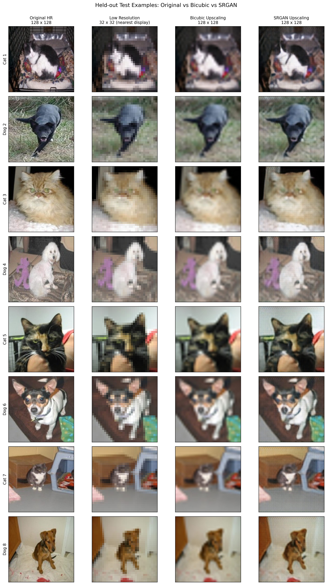
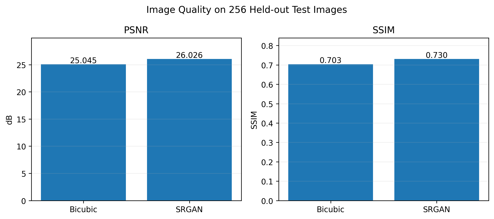
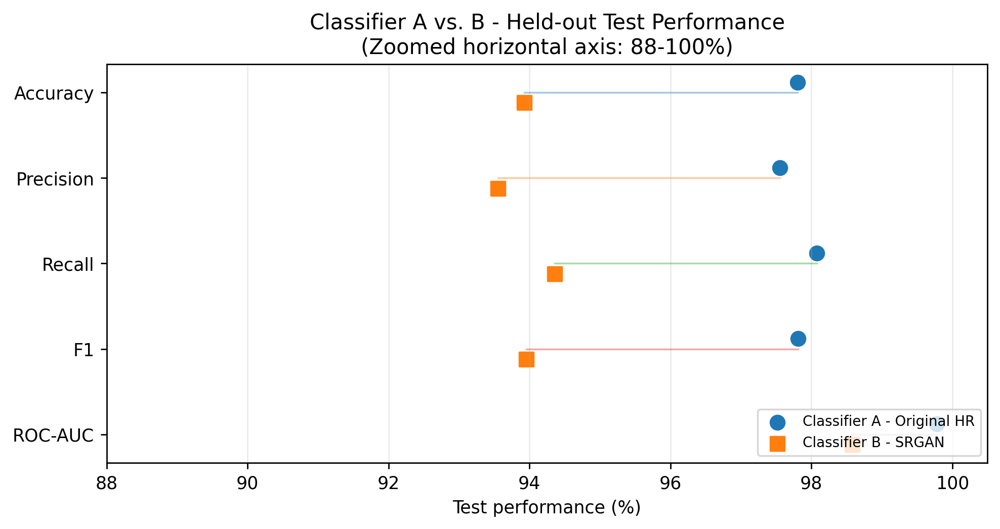

# SRGAN Midterm Project – Cats and Dogs

This project compares two ways of classifying cat and dog images. Model A uses the original images resized to 128 × 128 pixels. For Model B, I first reduce the images to 32 × 32 pixels and then use an SRGAN generator to bring them back to 128 × 128. Both classifiers use MobileNetV2.

The work started in Google Colab and was finished in Kaggle because the SRGAN training took longer than expected. The notebooks are arranged in the order I used them.

## What you need

- A Google account for Colab and Google Drive
- A Kaggle account with GPU access
- The public Kaggle dataset [`blourdhuraju/dogs-vs-cats-classification`](https://www.kaggle.com/datasets/blourdhuraju/dogs-vs-cats-classification)
- Python with TensorFlow, NumPy, pandas, Pillow, scikit-learn, SciPy, Matplotlib, and kagglehub (see `requirements.txt`)

The notebooks were run in Colab and Kaggle, so a local installation is not necessary. Select a GPU before starting the training. I used a fixed random seed of 42, but exact results can still vary between runs and software versions.

## Run the project

### 1. Prepare the data in Colab

Open `notebooks/01_colab_classifier_A_and_srgan_to_epoch27.ipynb` in Google Colab. Enable a GPU using **Runtime → Change runtime type**, then run the setup cells.

The notebook mounts Google Drive and downloads the public dataset with `kagglehub`. It creates the project directory in `MyDrive/Applied_AI_Midterm_SRGAN` and saves the train/validation/test split to `data/dataset_split.csv`.

My split contained **15,705 training**, **1,746 validation**, and **7,479 test** images. All images were converted to RGB and resized to 128 × 128 pixels using bicubic interpolation. The smaller input images were generated at 32 × 32 pixels.

Keep the saved split file. It is important that Models A and B use the same images in each subset.

### 2. Train Classifier A

Continue with the **Classifier A** section of notebook 01.

First, MobileNetV2 is loaded with ImageNet weights. The backbone is frozen while the classification head is trained. Afterwards, the last 30 backbone layers are considered for fine-tuning; BatchNormalization layers stay frozen.

Classifier A uses the 128 × 128 original images. The final model is saved as `checkpoints/model_A/model_A_final.keras`. This model is used again in the Kaggle evaluation, so keep a copy of it.

### 3. Pretrain the generator and start SRGAN training

Still in notebook 01, run the generator setup and the five-epoch pretraining section. Then continue with the **GroupNorm** adversarial-training section.

There were earlier discriminator experiments during development. The final version uses GroupNormalization in the discriminator and eight residual blocks in the generator. The Colab part ends after **adversarial epoch 27**.

At the end of notebook 01, run the export cell. It checks the saved state and downloads `srgan_kaggle_transfer.zip`. Keep this ZIP file: it contains the files needed to continue training in Kaggle, including the optimizer checkpoint.

### 4. Move the checkpoint to Kaggle

Create a private Kaggle dataset to hold the checkpoint files. Extract `srgan_kaggle_transfer.zip` before uploading its contents. The mounted files must be accessible under a `project/` directory, for example:

```text
project/
  data/dataset_split.csv
  checkpoints/model_A/model_A_final.keras
  checkpoints/srgan/groupnorm_v2/resume/
```

The notebook paths use my original Kaggle dataset name (`niklasohlenroth/applied-ai-midterm-srgan-checkpoints`). **Change that dataset name to your own** in the Kaggle notebooks. Also attach the public cats-and-dogs dataset.

Open `notebooks/02_kaggle_srgan_resume_to_epoch150.ipynb` in Kaggle and check that its first path checks find both datasets. Do not continue if the epoch-27 checkpoint is missing.

### 5. Finish the SRGAN training in Kaggle

Run the first training section of notebook 02 to continue from **epoch 27 to 125**. The code saves checkpoints and uploads them to the private dataset.

Once that upload has finished, refresh the dataset attached to the notebook and start the second training section in a new Kaggle session. It restores epoch 125 and continues to **epoch 150**. Do not use Kaggle's **Run All** option across this hand-off: the two parts require different checkpoint versions.

The final generator is chosen using **validation PSNR**, not the test set. In my run the selected model came from **epoch 107**, saved as `generator_best_psnr.keras`.

This is the longest part of the project. Full SRGAN training can take many GPU hours, so leave enough time and check the uploaded checkpoints before ending a session.

### 6. Train Classifier B

Attach the latest private checkpoint dataset and open `notebooks/03_kaggle_classifier_B_and_final_evaluation.ipynb`.

Classifier B uses the same MobileNetV2 architecture as Classifier A. The difference is its input: each 128 × 128 image is downsampled to 32 × 32, reconstructed by the frozen SRGAN generator, and then passed to the classifier.

Run the head-training section first, then the fine-tuning section. SRGAN reconstructions are cached before applying random image augmentation so that they do not need to be generated again in every fine-tuning epoch.

My run stopped after **9 head-training epochs** and **11 fine-tuning epochs**. Early stopping may give a different number of epochs in another run. The selected classifier is saved as `checkpoints/model_B/model_B_finetuned_final.keras`.

### 7. Evaluate both classifiers

Use the remaining sections of notebook 03. They load the two saved classifiers and evaluate them on exactly the same **7,479 test images**, without random augmentation. The notebook saves predicted probabilities, classification metrics, confusion matrices, ROC curves, and a paired comparison.

The image-quality section also compares bicubic upscaling with SRGAN on **256 test images** (128 cats and 128 dogs). It calculates PSNR and SSIM and saves side-by-side examples of the original, low-resolution, bicubic, and SRGAN images.

Results and figures are saved in the project's `results/` folders. The Kaggle code uploads them with the checkpoint backup.

## Results to compare against

These are the values from my completed run. A fresh run should give similar results, but it may not reproduce every decimal place.

| Test metric | Model A: original images | Model B: SRGAN images |
| --- | ---: | ---: |
| Accuracy | 97.81% | 93.93% |
| Precision | 97.55% | 93.55% |
| Recall | 98.07% | 94.35% |
| F1-score | 97.81% | 93.95% |
| ROC-AUC | 0.9978 | 0.9858 |

On the 256-image quality sample, mean **PSNR** was **25.0447 dB** for bicubic and **26.0263 dB** for SRGAN. Mean **SSIM** was **0.7033** for bicubic and **0.7302** for SRGAN.

SRGAN improved these image-quality measures, but the classifier using original images was still more accurate. This experiment does **not** include a separately trained classifier using bicubic-upscaled images, so it does not directly test whether SRGAN is better than bicubic for classification.

## Figures from my run

These figures are saved outputs from the Kaggle evaluation. They are included as examples of what the notebooks produce.

**Image reconstruction.** The columns show the original 128 × 128 image, a 32 × 32 version displayed with nearest-neighbor scaling, bicubic upscaling, and the SRGAN output. The images are selected examples from the held-out test set.



**Image-quality comparison.** Mean PSNR and SSIM from 256 held-out test images:



**Classification results.** Accuracy, precision, recall, F1 and ROC-AUC on the same 7,479 held-out images:



The remaining plots are available separately:

- [Confusion matrices](figures/classifier_comparison/test_confusion_matrices.png)
- [ROC curves](figures/classifier_comparison/test_roc_curves.png)
- [SRGAN validation PSNR and SSIM during training](figures/training_diagnostics/srgan_training_quality_history.png)
- [Classifier A training curves, reconstructed from Colab logs](figures/classifier_A/classifier_A_accuracy_recovered.png)

The figures are for checking the reproduced outputs, not an extra step required to train either classifier. The classification plots use the saved test predictions; the quality examples and PSNR/SSIM plots use the 256-image sample.

## Repository files

```text
notebooks/
  01_colab_classifier_A_and_srgan_to_epoch27.ipynb
  02_kaggle_srgan_resume_to_epoch150.ipynb
  03_kaggle_classifier_B_and_final_evaluation.ipynb
  archive/                       # original development notebooks
results/                         # saved summary tables
figures/
  classifier_A/                   # curves recovered from Colab logs
  classifier_comparison/          # test metrics, ROC and confusion matrices
  srgan_quality/                  # visual examples and PSNR/SSIM
  training_diagnostics/           # SRGAN learning curves
scripts/export_kaggle_figures.py
requirements.txt
README.md
```

The original notebooks are included in `notebooks/archive/` with execution outputs removed. The three numbered notebooks contain the cleaned workflow. They were checked for Python syntax, but the full Colab-to-Kaggle training process has **not** been rerun after cleanup.

Model weights, full training checkpoints, and the original split CSV were stored in a **private Kaggle dataset** and are not included in this GitHub repository. To start from scratch, follow notebook 01 to regenerate the split and models. The exact original results require the original checkpoints and split; following these steps without them should produce similar, not identical, results.
